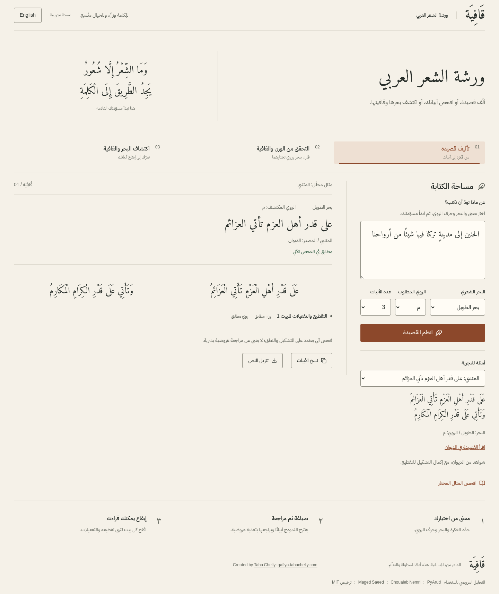
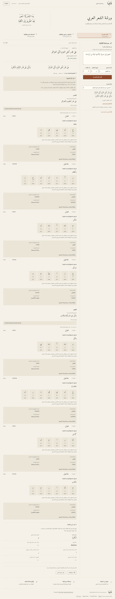
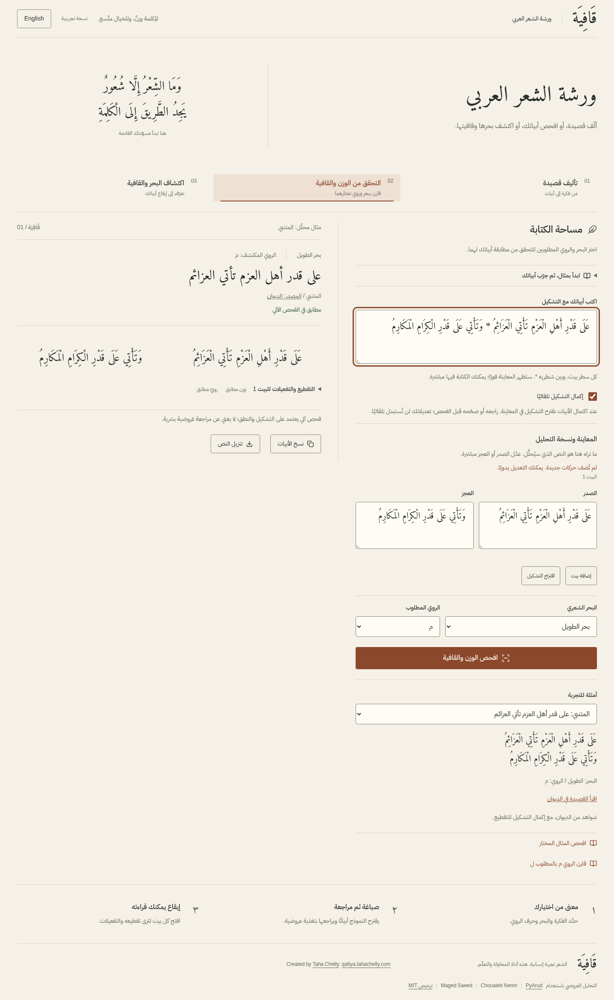
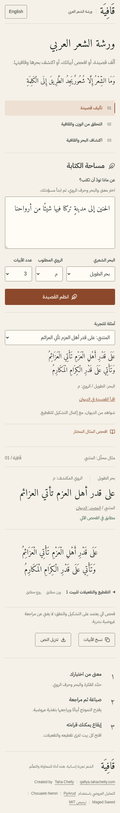

# قافية · Qafiya

**An Arabic poetry workshop for exploring classical meter, rhyme, and the rhythm of a verse.**

Created by **Taha Chelly** · [Live demo](https://qafiya.tahachelly.com/)

[How it works](#how-it-works) · [Run locally](#run-locally) · [Technical reports](#technical-reports)

[](https://github.com/taha3313/arabic-poetry/actions/workflows/ci.yml)

Qafiya brings an Arabic-first, right-to-left writing desk together with classical
prosody analysis. Compose a draft, check a poem against a chosen **بحر** (meter) and **روي**
(rhyme letter), or detect its meter and rhyme without choosing a target. Review
each **صدر** and **عجز** in an editable preview, then inspect its scansion.
Optional local vocalization suggests missing diacritics before analysis.

The public workshop offers **Compose, Check, and Detect** modes. As checked on
2026-11-02, the live API reports generation enabled with Gemini. Drafting and
targeted repair remain experimental and subject to provider quota and availability.
Local development also supports OpenRouter and Groq with your own provider key.

## Screenshots

### The writing desk



### Verse analysis and scansion

The default al-Mutanabbī example shows meter, rawi, binary scansion,
metrical feet, and the status of each hemistich.



### Review before analysis

Edit either half-line and review suggested vowel marks before checking or detecting
the meter.



<details>
<summary>Mobile view · 390px</summary>
<br />

</details>

Screenshots refreshed on 2026-11-02 show the deployed Qafiya interface. The sample poem is labelled as
an existing classical work, not AI-generated output.

## Interface languages

Use the **English / العربية** button to switch between Arabic and English. The choice is remembered in this browser; share `https://qafiya.tahachelly.com/?lang=en` for the English interface or `?lang=ar` for Arabic. Interface labels, analysis guidance, and known API errors are translated. Poems and Arabic metrical notation remain in Arabic, with right-to-left text direction. English meter names are transliterated rather than translated literally.

## Features

- **Classical Arabic prosody:** choose among 16 meters and compare the detected
  rawi with the requested letter using [PyArud](https://github.com/cnemri/pyarud).
- **Meter detection:** infer the meter and dominant rawi without supplying a
  target, and inspect whether the verses share a consistent rhyme.
- **Editable preview:** correct either half-line directly, review suggested
  vowels, compare or restore the original text, and analyze exactly your reviewed
  version. Delayed suggestions cannot overwrite newer edits.
- **Readable scansion:** expand a verse to inspect its binary rhythm, feet,
  accepted variations, and separate meter/rhyme results. Pronounced letters align
  with rhythm symbols only when the mapping is exact. PyArud’s prosodic spelling
  stays verbatim, including shadda expansion and pronounced tanween.
- **Optional automatic tashkeel:** a bundled approximately 4.8 MB libtashkeel
  ONNX model fills missing marks locally on the backend. Existing supplied
  vowels are preserved, and changes are disclosed. Analysis makes no LLM call.
- **Experimental AI drafting:** select a theme, meter, rhyme letter, and 1–8
  verses. The local example configuration uses OpenRouter with a free Gemma model;
  Gemini and Groq are also supported.
- **Targeted revisions:** failed verses receive specific feedback; the backend
  preserves accepted verses and sound hemistichs rather than relying on the
  provider to keep them unchanged. Interrupted revisions retain the best draft.
- **Arabic-first interface:** responsive RTL layout, keyboard focus states,
  reduced-motion support, attributed classical examples and Muʿallaqāt, copy,
  and plain-text download. Arabic and English interface choices persist locally.

## How it works

### Analyze your verses

1. Choose **Check** to compare against a meter and rawi, or **Detect** to infer
   them. Enter one verse per line with `*` between صدر and عجز, or load an
   attributed classical example. The opening sample is by al-Mutanabbī.
2. Edit the labeled half-line fields in the live preview. With automatic tashkeel
   enabled, complete input receives vowel suggestions after 900 ms of idle typing.
   Review or correct them, request suggestions explicitly, or restore the original.
3. Run the check or detection. The interface submits the reviewed text with
   `auto_tashkeel=false`, so analysis does not vocalize it a second time. Expand
   the result for feet and pronounced-letter scansion. Editing the draft marks
   the previous result as stale. If suggestions fail, manual analysis remains available.

### Draft and revise

The generation adapter requests structured verse pairs, then PyArud checks each
verse against the selected meter and rawi. Failed constraints feed a bounded
revision loop: two revisions by default, at most three through the API. Repairs
start from the strongest completed draft and preserve sound text.

**Machine acceptance is not literary or expert prosodic certification.** Results
depend on vocalization and pronunciation. Rawi equality is not full classical
qafiyah validation; meaning, grammar, originality, and poetic quality still need
human review. Bare-text vocalization remains limited: on the documented 12-verse
sample, completion improved partial-source meter matches from 2/12 to 10/12,
while fully unvocalized input reached only 2/12. See the
[tashkeel report](docs/TASHKEEL.md) for methodology and limitations.

## Stack and architecture

| Layer | Implementation |
| --- | --- |
| Frontend | React 19, TypeScript, Vite, Arabic fonts, Lucide icons |
| API | FastAPI, Pydantic, Python 3.12, uv |
| Prosody | PyArud 1.0.0 |
| Vocalization | libtashkeel model, CPU ONNX Runtime, NumPy |
| Generation | OpenRouter free-model adapter; optional native Gemini/Groq |
| Hosting | Cloudflare Pages frontend, Render free-plan Docker API in Frankfurt |
| CI | Backend tests/Ruff, frontend build, constrained production-container checks |

The vocalization runtime uses **no PyTorch, Transformers, TensorFlow, GPU, or
external model server**. The model and its upstream MIT license/provenance are
bundled in the repository; runtime does not download weights. One Uvicorn worker
shares the bounded, serialized ONNX session.

The actual production Docker image passed a whole-ASGI workload under **512 MiB
RAM / 0.1 CPU**, peaking at **142.55 MiB process RSS**, with no OOM. This is a
measured local workload, not a guarantee under arbitrary public traffic.
[Raw memory evidence](docs/evals/deployment-container-memory.json).

```text
frontend/                 React application and browser smoke scripts
backend/app/              API, provider adapters, prosody, bundled ONNX assets
backend/tests/            Regression tests and poetry fixtures
scripts/check-container.sh Production-image memory and runtime checks
docs/                     Design notes, evaluations, screenshots, deployment guide
render.yaml               Reference Render configuration
.github/workflows/ci.yml  GitHub Actions checks
```

## Run locally

Requires **Python 3.12**, **uv**, and **Node.js 24** (the hosted/CI version).
Analysis works without a provider key.

```bash
git clone https://github.com/taha3313/arabic-poetry.git
cd arabic-poetry
make setup
# First setup only; preserve an existing private .env.
cp -n backend/.env.example backend/.env
```

Start the servers in separate terminals:

```bash
make backend
```

```bash
make frontend
```

Open [localhost:5173](http://localhost:5173). Vite proxies local API requests to
FastAPI on port 8000. Try **استكشف مثالًا** to inspect a classical verse.

### Optional generation

Set these values in the ignored `backend/.env` file:

```dotenv
GENERATION_ENABLED=true
PROVIDER=openrouter
OPENROUTER_API_KEY=your-key
OPENROUTER_MODEL=google/gemma-4-31b-it:free
```

Keep keys on the backend. Model/key changes in the local dotenv file apply on
the next request; startup settings such as CORS require a restart. The default
OpenRouter model is a free Gemma 4 31B model; free-model availability and
provider rate limits can change. If the selected OpenRouter model is rate-limited
or returns no draft text, the backend makes one bounded retry through
`openrouter/free`. Temporary upstream failures and truncated completions also
use this single fallback. The named model uses reasoning effort `none`; the free
router uses `low`, since it can select models that require reasoning and reject
`none`. Both requests retain a 3,000-token total output budget. Low effort does
not guarantee visible output: a reasoning model can still exhaust that budget.
Strict JSON schemas close both draft and verse objects. This
does not bypass account-wide provider limits, and there is no fallback to another
provider. Provider prompts and draft poetry leave the backend only when generation
is requested.

Local OpenRouter checks on 2026-10-31 reproduced intermittent HTTP 400 rejections
with the router's disabled-reasoning setting, alongside repeated 429 responses
from the configured Gemma model. With low router reasoning effort, a subsequent
request exhausted the output budget without draft text. Other bounded runs
completed drafting and revision but failed meter/rhyme validation. Free routing
therefore remains experimental, with no reliability or poetic-quality guarantee.
Interrupted revisions keep the best validated draft and include a safe warning;
provider error bodies and generated text are not logged by the adapter.

For Groq, set `PROVIDER=groq`, `GROQ_API_KEY`, and optionally `GROQ_MODEL`
(default `openai/gpt-oss-120b`). For OpenRouter, use `PROVIDER=openrouter`,
`OPENROUTER_API_KEY`, and a named free model ending in `:free` (the default is
`google/gemma-4-31b-it:free`). Gemini remains available with its native adapter,
key rotation, and quota handling. Adapter support does not imply equal poetic
quality; read the [Gemini](docs/GEMINI.md) and [Groq](docs/GROQ.md) evaluation
notes.

## API

| Method | Route | Purpose |
| --- | --- | --- |
| `GET` | `/health` | Process health |
| `GET` | `/api/config` | Meters, provider/model names, generation availability |
| `POST` | `/api/tashkeel` | Suggest missing vowel marks without meter analysis |
| `POST` | `/api/analyze` | Check supplied verses against a meter and rawi |
| `POST` | `/api/detect` | Infer meter, dominant rawi, and rhyme consistency |
| `POST` | `/api/generate` | Generate and revise a draft when enabled |

Interactive local API documentation: [localhost:8000/docs](http://localhost:8000/docs).

```json
{
  "verses": [
    {
      "sadr": "قِفَا نَبْكِ مِنْ ذِكْرَى حَبِيبٍ وَمَنْزِلِ",
      "ajuz": "بِسِقْطِ اللِّوَى بَيْنَ الدَّخُولِ فَحَوْمَلِ"
    }
  ],
  "meter": "taweel",
  "rawi": "ل",
  "auto_tashkeel": true
}
```

Checking, detection, and vowel suggestions accept up to eight verses and
240 characters per hemistich excluding vowel marks, with a 720-character
serialized ceiling for vocalized text. Generated halves are limited to 240
serialized characters; generation topics to 500 characters. Provider attempts have 75-second
timeouts. Each key gets at most one quota attempt per completion; exhausted keys are skipped
on subsequent requests during cooldown. Gemini 503/504 overload receives one
short-delay retry unless Retry-After is present. Public generation permits one
active request per process; the existing deployment uses one process. Cooldowns
are process-local and reset on restart. Errors contain safe messages and quota
responses include Retry-After.

## Development and verification

```bash
make test
make build
cd frontend
npm test
cd ../backend
uv run ruff check .
uv run ruff format --check .
cd ..
docker build -t qafiya-api:local backend
bash scripts/check-container.sh qafiya-api:local
```

The editable-preview release record reports **103 backend tests and seven
frontend tests**; see the [responsive and accessibility review](docs/qa/preview-accessibility-responsive.md)
for its scope and limitations. GitHub CI runs backend tests/Ruff, frontend tests
and a production build, and the production Docker image
under a 512 MiB cap without provider credentials or network access during the
runtime workload. See [verification notes](docs/VERIFICATION.md) for browser
checks, evidence, and remaining limits.

Docker Compose is also included. It serves the frontend on port 5173 and proxies
`/api` to the backend. Use a Compose-compatible private dotenv file via
`BAYT_ENV_FILE` if needed; the [deployment guide](docs/DEPLOYMENT.md) explains the
existing local env-file parser limitation.

## Deployment

The public site runs at **[qafiya.tahachelly.com](https://qafiya.tahachelly.com)**.
Its analysis flow, CPU vocalization, cross-origin requests, and HTTPS have been
checked after deployment. The live API reported `generation_available=true` on
2026-11-02 with Gemini; this configuration check does not establish generation
quality or remaining quota. Generation is serialized per process, with bounded
revisions and provider cooldowns. These controls do not provide authentication
or durable per-user quotas; CORS alone does not protect a shared provider key.

For separate hosting, set `VITE_API_BASE_URL` to the HTTPS backend origin at
frontend build time, and configure the backend’s `CORS_ORIGINS` as an exact-origin
JSON list. Never put secrets in `VITE_*` variables. Render auto-deploys are
disabled; the checked-in Blueprint is reference configuration for the existing
service. See the [deployment guide](docs/DEPLOYMENT.md) for actual resource IDs,
build settings, release steps, and the default TCP health-check limitation.

## Technical reports

- [Generation prompts and sound-hemistich preservation](docs/PROMPTS.md)
- [CPU tashkeel, quality limits, model provenance, and memory measurements](docs/TASHKEEL.md)
- [Classical poem input evaluation](docs/ALDIWAN-QA.md)
- [Gemini integration and live sample evidence](docs/GEMINI.md)
- [Groq comparison and unresolved generation quality](docs/GROQ.md)
- [UI design decisions](docs/DESIGN.md)
- [Editable preview and suggestion behavior](docs/editable-poetry-preview.md)
- [Responsive, accessibility, and preview QA](docs/qa/preview-accessibility-responsive.md)
- [Attributed poetry examples](docs/poetry-examples.md)
- [Verification record](docs/VERIFICATION.md)
- [Deployment operations](docs/DEPLOYMENT.md)

The bundled libtashkeel assets include their upstream MIT license. A
repository-wide application license has not been selected.

## Acknowledgments

Qafiya’s Arabic meter, rhyme, and scansion analysis uses [PyArud](https://github.com/cnemri/pyarud), authored by Chouaieb Nemri. Its MIT license credits copyright holders Maged Saeed (2022) and Chouaieb Nemri (2025). Thank you to the authors and contributors for making this work available. The complete upstream [license notice](frontend/public/licenses/pyarud.txt) is preserved and linked from the application footer.
