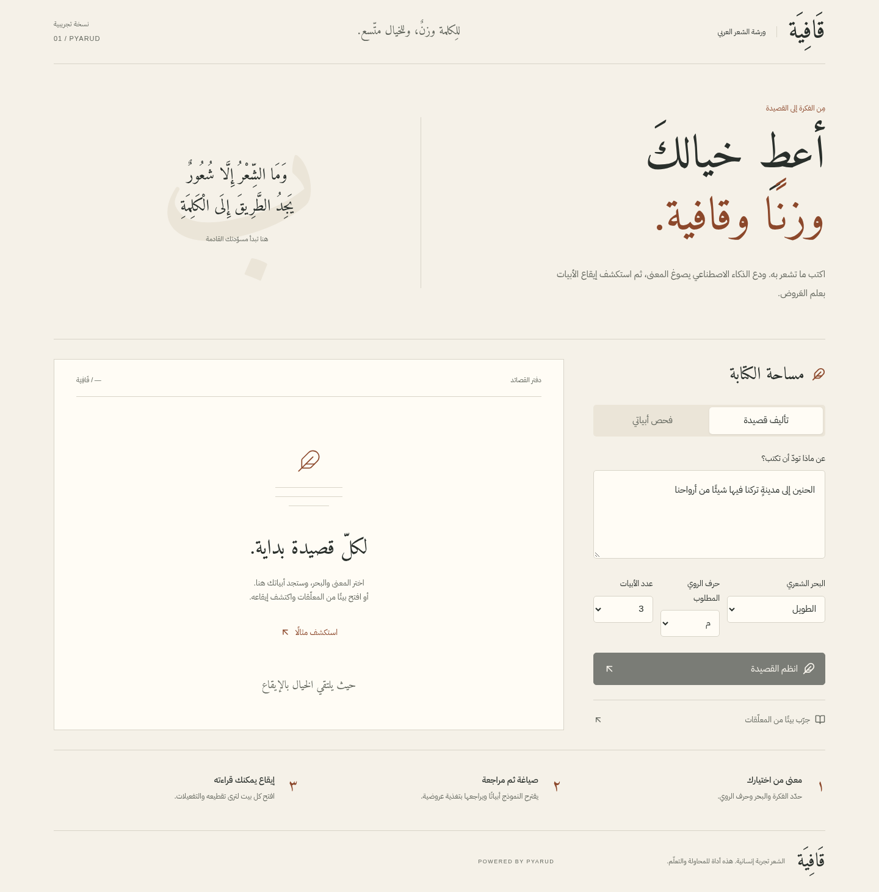
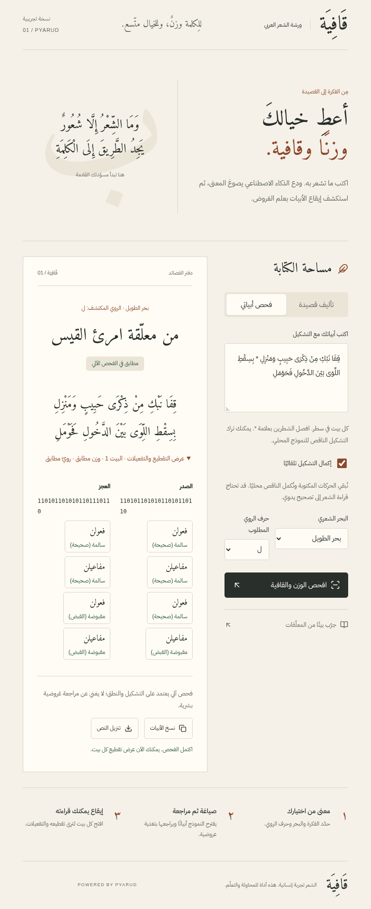
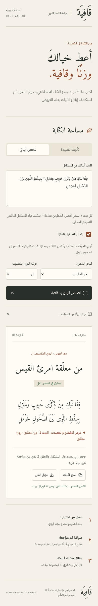

# قافية · Qafiya

**An Arabic poetry workshop for exploring classical meter, rhyme, and the rhythm of a verse.**

Created by **Taha Chelly** · [Live demo](https://qafiya.tahachelly.com/)

[How it works](#how-it-works) · [Run locally](#run-locally) · [Technical reports](#technical-reports)

[](https://github.com/taha3313/arabic-poetry/actions/workflows/ci.yml)

Qafiya brings an Arabic-first, right-to-left writing desk together with classical
prosody analysis. Paste a poem, choose its **بحر** (meter) and **روي** (rhyme
letter), and inspect the scansion of each **صدر** and **عجز**. Optional local
vocalization fills missing diacritics before analysis.

**The public demo currently offers analysis. AI generation is disabled on the
hosted instance.** The repository also includes an experimental drafting and
targeted-repair workflow that can be enabled locally with your own provider key.

## Screenshots

### The writing desk



### Verse analysis and scansion

The sample from Imru’ al-Qais shows detected meter, rawi, binary scansion,
metrical feet, and the status of each hemistich.



<details>
<summary>Mobile view · 390px</summary>
<br />

</details>

Screenshots show the deployed Qafiya interface. The sample poem is labelled as
an existing classical work, not AI-generated output.

## Interface languages

Use the **English / العربية** button to switch between Arabic and English. The choice is remembered in this browser; share `https://qafiya.tahachelly.com/?lang=en` for the English interface or `?lang=ar` for Arabic. Interface labels, analysis guidance, and known API errors are translated. Poems and Arabic metrical notation remain in Arabic, with right-to-left text direction. English meter names are transliterated rather than translated literally.

## Features

- **Classical Arabic prosody:** choose among 16 meters and compare the detected
  rawi with the requested letter using [PyArud](https://github.com/cnemri/pyarud).
- **Readable scansion:** expand a verse to inspect its binary rhythm, feet,
  accepted variations, and separate meter/rhyme results.
- **Optional automatic tashkeel:** a bundled approximately 4.8 MB libtashkeel
  ONNX model fills missing marks locally on the backend. Existing supplied
  vowels are preserved, and changes are disclosed. Analysis makes no LLM call.
- **Experimental AI drafting:** select a theme, meter, rhyme letter, and 1–8
  verses. Gemini is the default adapter; Groq and OpenRouter are optional.
- **Targeted revisions:** failed verses receive specific feedback; the backend
  preserves accepted verses and sound hemistichs rather than relying on the
  provider to keep them unchanged. Interrupted revisions retain the best draft.
- **Arabic-first interface:** responsive RTL layout, keyboard focus states,
  reduced-motion support, sample exploration, copy, and plain-text download.

## How it works

### Analyze your verses

1. Open **فحص أبياتي** and enter one verse per line, separating صدر and عجز
   with `*`, or choose the labelled classical example.
2. Select a meter and requested rawi. Leave automatic tashkeel enabled to fill
   missing marks, or disable it to scan the original input.
3. Inspect the result and expand each verse’s scansion. The manuscript displays
   the actual analyzed text; the original input remains available.

### Draft and revise locally

The generation adapter requests structured verse pairs, then PyArud checks each
verse against the selected meter and rawi. Failed constraints feed a bounded
revision loop: two revisions by default, at most three through the API. Repairs
start from the strongest completed draft and preserve sound text.

**Machine acceptance is not literary or expert prosodic certification.** Results
depend on vocalization and pronunciation. Rawi equality is not full classical
qafiyah validation; meaning, grammar, originality, and poetic quality still need
human review. Bare-text vocalization remains limited: on the documented 12-verse
sample, completion improved partial-source meter matches from 2/12 to 10/12,
while fully unvocalized input reached only 2/12. See the
[tashkeel report](docs/TASHKEEL.md) for methodology and limitations.

## Stack and architecture

| Layer | Implementation |
| --- | --- |
| Frontend | React 19, TypeScript, Vite, Arabic fonts, Lucide icons |
| API | FastAPI, Pydantic, Python 3.12, uv |
| Prosody | PyArud 1.0.0 |
| Vocalization | libtashkeel model, CPU ONNX Runtime, NumPy |
| Generation | Native Gemini adapter; optional Groq/OpenRouter |
| Hosting | Cloudflare Pages frontend, Render free-plan Docker API in Frankfurt |
| CI | Backend tests/Ruff, frontend build, constrained production-container checks |

The vocalization runtime uses **no PyTorch, Transformers, TensorFlow, GPU, or
external model server**. The model and its upstream MIT license/provenance are
bundled in the repository; runtime does not download weights. One Uvicorn worker
shares the bounded, serialized ONNX session.

The actual production Docker image passed a whole-ASGI workload under **512 MiB
RAM / 0.1 CPU**, peaking at **142.55 MiB process RSS**, with no OOM. This is a
measured local workload, not a guarantee under arbitrary public traffic.
[Raw memory evidence](docs/evals/deployment-container-memory.json).

```text
frontend/                 React application and browser smoke scripts
backend/app/              API, provider adapters, prosody, bundled ONNX assets
backend/tests/            Regression tests and poetry fixtures
scripts/check-container.sh Production-image memory and runtime checks
docs/                     Design notes, evaluations, screenshots, deployment guide
render.yaml               Reference Render configuration
.github/workflows/ci.yml  GitHub Actions checks
```

## Run locally

Requires **Python 3.12**, **uv**, and **Node.js 24** (the hosted/CI version).
Analysis works without a provider key.

```bash
git clone https://github.com/taha3313/arabic-poetry.git
cd arabic-poetry
make setup
# First setup only; preserve an existing private .env.
cp -n backend/.env.example backend/.env
```

Start the servers in separate terminals:

```bash
make backend
```

```bash
make frontend
```

Open [localhost:5173](http://localhost:5173). Vite proxies local API requests to
FastAPI on port 8000. Try **استكشف مثالًا** to inspect a classical verse.

### Optional generation

Set these values in the ignored `backend/.env` file:

```dotenv
GENERATION_ENABLED=true
PROVIDER=gemini
GEMINI_API_KEY=your-key
GEMINI_API_KEY_2=second-key
GEMINI_API_KEY_3=third-key
GEMINI_MODEL=gemini-3.5-flash
GEMINI_THINKING_LEVEL=medium
```

Keep keys on the backend. Model/key changes in the local dotenv file apply on
the next request; startup settings such as CORS require a restart. Provider
quota, availability, and billing remain account-specific. There is no automatic
provider fallback. Gemini rotates through at most three distinct configured keys
on quota rejection, remembers a working key, and cools exhausted keys until at
least the provider retry hint (60 seconds by default; 24 hours for daily/zero quota).
Keys in one project share quota; rotation does not multiply project limits.
Optionally set `GEMINI_KEY_PROJECTS={"1":"project-a","2":"project-a","3":"project-b"}`
to apply structured project quota cooldowns to sibling keys without probing them.
Unknown project relationships receive only one bounded attempt per key. Provider prompts and draft poetry leave the
backend only when generation is requested.

For Groq, set `PROVIDER=groq`, `GROQ_API_KEY`, and optionally `GROQ_MODEL`
(default `openai/gpt-oss-120b`). For OpenRouter, use `PROVIDER=openrouter`,
`OPENROUTER_API_KEY`, and `OPENROUTER_MODEL=openrouter/free` or a named `:free`
model. Adapter support does not imply equal poetic quality; read the
[Gemini](docs/GEMINI.md) and [Groq](docs/GROQ.md) evaluation notes.

## API

| Method | Route | Purpose |
| --- | --- | --- |
| `GET` | `/health` | Process health |
| `GET` | `/api/config` | Meters, provider/model names, generation availability |
| `POST` | `/api/analyze` | Analyze supplied verses; optional local tashkeel |
| `POST` | `/api/generate` | Generate and revise a draft when enabled |

Interactive local API documentation: [localhost:8000/docs](http://localhost:8000/docs).

```json
{
  "verses": [
    {
      "sadr": "قِفَا نَبْكِ مِنْ ذِكْرَى حَبِيبٍ وَمَنْزِلِ",
      "ajuz": "بِسِقْطِ اللِّوَى بَيْنَ الدَّخُولِ فَحَوْمَلِ"
    }
  ],
  "meter": "taweel",
  "rawi": "ل",
  "auto_tashkeel": true
}
```

Inputs are bounded to eight verses, 240 serialized characters per hemistich,
and 500 characters per generation topic. Provider attempts have 75-second
timeouts. Each key gets at most one quota attempt per completion; exhausted keys are skipped
on subsequent requests during cooldown. Gemini 503/504 overload receives one
short-delay retry unless Retry-After is present. Public generation permits one
active request per process; the existing deployment uses one process. Cooldowns
are process-local and reset on restart. Errors contain safe messages and quota
responses include Retry-After.

## Development and verification

```bash
make test
make build
cd backend
uv run ruff check .
uv run ruff format --check .
cd ..
docker build -t qafiya-api:local backend
bash scripts/check-container.sh qafiya-api:local
```

The deployment baseline has **73 passing backend tests**. GitHub CI runs the
backend checks, a frontend production build, and the production Docker image
under a 512 MiB cap without provider credentials or network access during the
runtime workload. See [verification notes](docs/VERIFICATION.md) for browser
checks, evidence, and remaining limits.

Docker Compose is also included. It serves the frontend on port 5173 and proxies
`/api` to the backend. Use a Compose-compatible private dotenv file via
`BAYT_ENV_FILE` if needed; the [deployment guide](docs/DEPLOYMENT.md) explains the
existing local env-file parser limitation.

## Deployment

The public site runs at **[qafiya.tahachelly.com](https://qafiya.tahachelly.com)**.
Its analysis flow, CPU vocalization, cross-origin requests, and HTTPS were checked
after deployment. Generation stays disabled until public request controls are
implemented and reviewed. CORS alone does not protect a shared provider key.

For separate hosting, set `VITE_API_BASE_URL` to the HTTPS backend origin at
frontend build time, and configure the backend’s `CORS_ORIGINS` as an exact-origin
JSON list. Never put secrets in `VITE_*` variables. Render auto-deploys are
disabled; the checked-in Blueprint is reference configuration for the existing
service. See the [deployment guide](docs/DEPLOYMENT.md) for actual resource IDs,
build settings, release steps, and the default TCP health-check limitation.

## Technical reports

- [Generation prompts and sound-hemistich preservation](docs/PROMPTS.md)
- [CPU tashkeel, quality limits, model provenance, and memory measurements](docs/TASHKEEL.md)
- [Classical poem input evaluation](docs/ALDIWAN-QA.md)
- [Gemini integration and live sample evidence](docs/GEMINI.md)
- [Groq comparison and unresolved generation quality](docs/GROQ.md)
- [UI design decisions](docs/DESIGN.md)
- [Verification record](docs/VERIFICATION.md)
- [Deployment operations](docs/DEPLOYMENT.md)

The bundled libtashkeel assets include their upstream MIT license. A
repository-wide application license has not been selected.

## Acknowledgments

Qafiya’s Arabic meter, rhyme, and scansion analysis uses [PyArud](https://github.com/cnemri/pyarud), authored by Chouaieb Nemri. Its MIT license credits copyright holders Maged Saeed (2022) and Chouaieb Nemri (2025). Thank you to the authors and contributors for making this work available. The complete upstream [license notice](frontend/public/licenses/pyarud.txt) is preserved and linked from the application footer.
